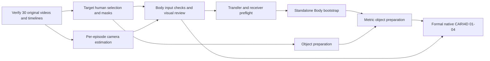

# Video preparation through the Body handoff

Updated 2026-10-15. This plan ends when a second worker can verify a complete input package and start the selected human model. It does not equate downloading videos, passing a raw-data gate, or starting inference with accepted human reconstruction.

## Boundary and execution order

Prepare the common inputs for all 30 Track 1 episodes, then complete the model-specific handoff on episode **16** (foam grass block, 360 frames) and episode **12** (black pan, 405 frames). Use the measured failures and resource costs of these two full clips before expanding the expensive preprocessing to all 30. These are engineering cases, not an unbiased evaluation subset. Never divide a temporal sequence among workers without a separately validated stitching method.

There are two different consumers:

| Consumer | Required data | Work that can remain parallel |
| --- | --- | --- |
| Standalone SAM 3D Body bootstrap | Original RGB video; an actual target-human mask sequence or bounding-box track; project-approved Track 1 camera estimates; exact source timeline | Object segmentation, object reconstruction and metric mesh preparation |
| Formal native CARI4D 01-04 | Byte-identical video with the native filename; complete human/object masks in the native H5 schema; the real Track 1 metric object mesh; pinned runtime/model identities | Later native 05 and 06-07 wait for these outputs |

The Body API technically allows omitted camera intrinsics, but its default field of view is not a Track 1 estimate. It is therefore not the prepared-camera profile selected here. Do not generate a guessed focal length to pass the gate. If a separate exploratory default-FOV experiment is explicitly selected, give it a different profile and keep it out of calibrated-scale and final-acceptance claims.



Standalone Body outputs are bootstrap evidence. They do not silently replace the human/camera estimates recomputed by the formal native path. Preserve the two lineages and compare them before integration. See [distributed execution](distributed-execution.md).

## 1. Freeze and verify raw data

The input source is `nvidia/video_to_data_challenge` at revision `5f68335f3acc802033d1e80728c1633197521de8`. [The source lock](../configs/track1-source.json) contains only the Track 1 subtree. It records upstream file identities rather than trusting a mutable download URL.

From the repository root:

```bash
python -m pip install -e ".[video]"
python -m v2hoi.download --videos --revision 5f68335f3acc802033d1e80728c1633197521de8
python tools/prepare_track1_data.py --dataset-root data/v2d/track_1 --source-inventory configs/track1-source.json --output data/prepared/track1-20261015
```

Use a new output directory for a new check attempt. The gate must fail on wrong file bytes, missing episodes, decoding errors, changed dimensions, non-increasing PTS, or a disagreement between decoded frames and the official frame-index tables. The report records the decoder and runtime actually used.

The portable data boundary comprises the unchanged `track_1` subtree and the generated manifest, checks and complete per-episode timelines. Source frame IDs are zero-based presentation-order indices. PTS and its rational time base come from decoding the original source. Every subsequent crop, stride or resize must retain its mapping to this timeline.

Do not replace the sources with the repository's lower-resolution, lower-FPS gallery previews. Do not pre-extract 16,563 lossless images unless a chosen adapter actually needs them. Decode on the consumer and cache only its required representation, recording any image transforms.

**Completion:** all 30 raw videos pass. This is `raw_video_verified`, not a completed M1 camera/masks/depth delivery or `body_inputs_verified`.

## 2. Produce target-human observations

Start with episode 16, then episode 12. Select the target person from the video, record the original annotation frame and coordinates, and give that target a stable episode-local identity. The identifier itself is bookkeeping; it does not prove that a detector tracked the correct person.

Use the pinned prompted SAM2 route already present in the benchmark recipes, or a separately identified detector/tracker adapter. For the first reusable profile, provide human masks: they can serve both Body and later HOI. Derive bounding boxes from the actual masks if a consumer needs them. Preserve model revision, checkpoint hash, configuration, prompts, image transforms, edits and output hashes.

The pinned standalone Body reader expects `human_masks/000000.png` through the last original frame, at the original image dimensions. Validate that the files are single-channel binary masks and that all expected names occur exactly once. Sparse names can trigger upstream fallbacks; process exit 0 is not a coverage check.

For each frame, record observation state and confidence separately from the mask. An empty mask must mean an explicitly identified missing/occluded observation, not successful localization. Do not silently fill missing frames with full-image masks, copied boxes or invented observations. A missing localization blocks this first strict Body profile until the selected adapter has an explicit, reviewed handling policy. Retain the original frame in all coverage records.

Inspect overlays at the beginning, middle and end, at large mask-area/box changes, and around interaction/occlusion events. Automatic bounds and continuity checks help find failures but cannot certify target identity or segmentation quality. Record the actual reviewer and findings. Roles remain flexible.

**Completion:** source-bound, full-frame human observations with explicit validity and reviewed target identity. No reconstruction quality claim follows from this check.

## 3. Estimate the camera on the same episode

Run the selected pinned camera/depth estimator on permitted Track 1 pixels. Record the source frames, raw per-frame estimates, any image normalization and the rule used to select a static-camera estimate. Convert normalized intrinsics to the original 1536 x 1152 pixel grid with explicit transformations; never average raw values expressed in different resized grids.

The standalone wrapper consumes a JSON object with `fx`, `fy`, `cx`, `cy`, `width`, and `height`. Require finite positive focal lengths and dimensions consistent with the original video. Keep estimation provenance in a separate report. A physical camera label such as `back_stereo_camera_left` is not a calibration file and does not authorize evidence pooling between episodes.

Depth can be useful for later scale evidence, but it is not an additional standalone Body input. Retain needed native depth results for later tasks; do not make a full all-30 depth dump a prerequisite for the first human run. Camera estimation and segmentation can run on different machines because both reference the same frozen video/timeline.

**Completion:** a real Track 1 camera estimate, original-pixel conventions and a documented uncertainty/consistency review. A positive focal length alone does not establish camera accuracy or metric scale.

## 4. Assemble and check the Body package

The intended model-specific package below is a contract to implement after the raw gate. Empty templates are not successful artifacts.

```text
body-inputs/<result-id>/episode_000016/
  input.json                  # source video/timeline identities, targets, producer versions
  timeline.json               # exact copy of the verified original timeline
  human_masks/000000.png ...   # actual complete mask sequence
  observations.json           # frame IDs, validity, provenance and reviewed target
  intrinsics.json             # real camera estimate in original pixels
  camera-estimation.json      # method, source frames, raw estimates and transforms
  checks.json                 # typed input checks and unresolved issues
  review.json                 # actual visual review, not an automatic approval
  SHA256SUMS                  # complete dependency/output inventory
```

The original video can stay in a shared raw package if the handoff names its exact hash and includes that dependency. `input.json` must resolve every dependency after relocation; an absolute path from the producer is insufficient.

Before setting `body_inputs_verified`, a model-specific gate must check bytes, full-frame mask names and content, timeline identity, camera conventions, provenance and review records. Wrong episode, corrupt mask, changed video, missing last frame and changed calibration must fail. Changing any input invalidates the corresponding downstream result. This native Body gate is not yet implemented by the existing fake v1 gate or by the new raw-video verifier.

## 5. Verify on the receiving machine

Git carries the source lock, scripts, small manifests and review records. A result-specific archive or agreed team store carries masks and other large generated outputs. Raw videos can be downloaded independently from the same pinned source; check their hashes on every receiving machine. Do not put model binaries, complete videos or per-frame arrays in normal Git history.

The receiver records its actual runtime, source pin, model hashes, resolved paths and input verification. Do a short selected-frame loading/inference smoke test first, retain its original IDs, then run the complete episode. A smoke test is not a complete-video result. Verify output coverage, native parameter meanings and overlays separately from input readiness.

The inspected standalone wrapper is pinned at `33129dd0f2d2dcfd1164d43fd076542660756ed2`. A different native source pin must be explicitly reviewed; the historical recipe and newer Windows candidate are not interchangeable.

There is a concrete compatibility issue to resolve before invoking the historical standalone recipe: the library loads `<weights_dir>/sam-3d-body-dinov3/`, while the repository's CARI4D bundle stores those files under `<weights_dir>/checkpoints/sam-3d-body-dinov3/`. The Docker wrapper also expects `<weights_dir>/torch_home`. Prepare a separate hash-verified standalone weight view containing both direct `sam-3d-body-dinov3/` and `torch_home/`; merely passing the `checkpoints` directory changes the model path but loses the expected cache location. The current recipe has not been runtime-validated with that corrected view.

**Completion of this preparation task:** `body_inputs_verified` plus `body_receiver_preflight_passed`, with a selected adapter and complete dependencies. `body_execution_completed`, scientific review and final native-MHR acceptance are later, separate states.

## Current execution constraints

The current Windows host has an RTX 5070 Laptop GPU with about 8 GB VRAM. The CPU review environment has the video decoder, but does not have PyTorch, SAM2, Body code/weights or a Docker command on PATH. Historical model acquisition receipts and GitHub Releases do not mean that these runtimes are installed locally. No minimum-memory or successful Body inference claim has been measured here.

Complete the CPU raw-data gate locally. Choose an available compatible worker for masks/camera and for the first Body smoke test; members may provide different machines. Before expanding to all videos, observe preprocessing time, peak memory, output size, mask failure cases and camera consistency on episodes 16 and 12. Reuse those measurements to schedule the remaining complete episodes. No fixed personal assignment or new team deadline is implied.

## Pinned interface evidence

- [Standalone Body input and localization behavior](https://github.com/nvidia-isaac/video_to_data/blob/33129dd0f2d2dcfd1164d43fd076542660756ed2/reconstruction/modules/v2d_sam3d_body/lib/estimate_mhr_params.py)
- [FrameSource naming](https://github.com/nvidia-isaac/video_to_data/blob/33129dd0f2d2dcfd1164d43fd076542660756ed2/reconstruction/modules/v2d_common/video.py)
- [CameraIntrinsics fields](https://github.com/nvidia-isaac/video_to_data/blob/33129dd0f2d2dcfd1164d43fd076542660756ed2/reconstruction/modules/v2d_common/datatypes.py)
- [Body Docker wrapper and cache layout](https://github.com/nvidia-isaac/video_to_data/blob/33129dd0f2d2dcfd1164d43fd076542660756ed2/reconstruction/modules/v2d_sam3d_body/docker/run_estimate_mhr_params.py)
- [Full CARI4D dependencies](https://github.com/nvidia-isaac/video_to_data/blob/33129dd0f2d2dcfd1164d43fd076542660756ed2/reconstruction/modules/v2d_cari4d/lib/run_inference.py)

The raw-data verifier does not execute any of these model sources. Follow [R1-R6](track1-requirements.md), [platform scope](platform-plan.md), and the separate [module submission procedure](../deliveries/README.md).
