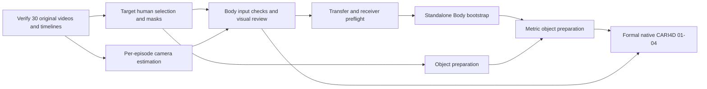

# Video preparation through the Body handoff

Updated 2026-10-16. The requested scope is a complete Body input handoff for **all 30 Track 1 videos**, not a two-video pilot. This preparation ends when the complete archive and the selected native input readers pass on the receiving copy. Body model runtime validation, inference and accepted human reconstruction remain separate states. See the [receiving guide](body-input-handoff.md) for exact package layout and consumer commands.

## Boundary and execution order

Prepare and verify every original frame of all 30 Track 1 episodes, including human masks, source timelines, episode-specific camera estimates and visual review evidence. Episode **16** (foam grass block, 360 frames) was an execution smoke test before the full batch; it is not the delivery boundary. Any remaining incomplete or rejected episode blocks the all-30 handoff. Never divide a temporal sequence among workers without a separately validated stitching method.

There are two different consumers:

| Consumer | Required data | Work that can remain parallel |
| --- | --- | --- |
| Standalone SAM 3D Body bootstrap | Original RGB video; an actual target-human mask sequence or bounding-box track; project-approved Track 1 camera estimates; exact source timeline | Object segmentation, object reconstruction and metric mesh preparation |
| Formal native CARI4D 01-04 | Byte-identical video with the native filename; complete human/object masks in the native H5 schema; the real Track 1 metric object mesh; pinned runtime/model identities | Later native 05 and 06-07 wait for these outputs |

The Body API technically allows omitted camera intrinsics, but its default field of view is not a Track 1 estimate. It is therefore not the prepared-camera profile selected here. Do not generate a guessed focal length to pass the gate. If a separate exploratory default-FOV experiment is explicitly selected, give it a different profile and keep it out of calibrated-scale and final-acceptance claims.



Standalone Body outputs are bootstrap evidence. They do not silently replace the human/camera estimates recomputed by the formal native path. Preserve the two lineages and compare them before integration. See [distributed execution](distributed-execution.md).

## 1. Freeze and verify raw data

The input source is `nvidia/video_to_data_challenge` at revision `5f68335f3acc802033d1e80728c1633197521de8`. [The source lock](../configs/track1-source.json) contains only the Track 1 subtree. It records upstream file identities rather than trusting a mutable download URL.

From the repository root:

```bash
python -m pip install -e ".[video]"
python -m v2hoi.download --videos --revision 5f68335f3acc802033d1e80728c1633197521de8
python tools/prepare_track1_data.py --dataset-root data/v2d/track_1 --source-inventory configs/track1-source.json --output data/prepared/track1-20261015
```

Use a new output directory for a new check attempt. The gate must fail on wrong file bytes, missing episodes, decoding errors, changed dimensions, non-increasing PTS, or a disagreement between decoded frames and the official frame-index tables. The report records the decoder and runtime actually used.

The portable data boundary comprises the unchanged `track_1` subtree and the generated manifest, checks and complete per-episode timelines. Source frame IDs are zero-based presentation-order indices. PTS and its rational time base come from decoding the original source. Every subsequent crop, stride or resize must retain its mapping to this timeline.

Do not replace the sources with the repository's lower-resolution, lower-FPS gallery previews. Do not pre-extract 16,563 lossless images unless a chosen adapter actually needs them. Decode on the consumer and cache only its required representation, recording any image transforms.

**Completion:** all 30 raw videos pass. This is `raw_video_verified`, not a completed M1 camera/masks/depth delivery or `body_inputs_verified`.

## 2. Produce target-human observations

For each of the 30 videos, select the target person from the video, record the original annotation frame and coordinates, and give that target a stable episode-local identity. The identifier itself is bookkeeping; it does not prove that a detector tracked the correct person.

The implemented producer, `tools/prepare_body_masks.py`, uses reviewed target prompts and pinned SAM2 propagation over each complete original sequence. Provide human masks: they can serve both Body and later HOI. Derive bounding boxes from the actual masks if a consumer needs them. Preserve model revision, checkpoint hash, configuration, prompts, image transforms, edits and output hashes. `tools/render_body_mask_qa.py` adds source-bound target crops beside the full-frame review sheets.

The pinned standalone Body reader expects `human_masks/000000.png` through the last original frame, at the original image dimensions. Validate that the files are single-channel binary masks and that all expected names occur exactly once. Sparse names can trigger upstream fallbacks; process exit 0 is not a coverage check.

For each frame, record observation state and confidence separately from the mask. An empty mask must mean an explicitly identified missing/occluded observation, not successful localization. Do not silently fill missing frames with full-image masks, copied boxes or invented observations. A missing localization blocks this first strict Body profile until the selected adapter has an explicit, reviewed handling policy. Retain the original frame in all coverage records.

Inspect overlays at the beginning, middle and end, at large mask-area/box changes, and around interaction/occlusion events. Automatic bounds and continuity checks help find failures but cannot certify target identity or segmentation quality. Record the actual reviewer and findings. Roles remain flexible.

**Completion:** source-bound, full-frame human observations with explicit validity and reviewed target identity. No reconstruction quality claim follows from this check.

## 3. Estimate the camera on the same episode

The implemented camera producer, `tools/prepare_body_camera.py`, runs pinned MoGe2 on 13 deterministic original frames spanning each complete episode, including both endpoints. It retains all raw estimates and uses their componentwise median, with no cross-episode pooling or sample removal. Convert normalized intrinsics to the original 1536 x 1152 integer pixel-center grid with the explicit transformation recorded in `camera-estimation.json`; never average values expressed in different resized grids.

The standalone wrapper consumes a JSON object with `fx`, `fy`, `cx`, `cy`, `width`, and `height`. Require finite positive focal lengths and dimensions consistent with the original video. Keep estimation provenance in a separate report. A physical camera label such as `back_stereo_camera_left` is not a calibration file and does not authorize evidence pooling between episodes.

Depth can be useful for later scale evidence, but it is not an additional standalone Body input. Retain needed native depth results for later tasks; do not make a full all-30 depth dump a prerequisite for the first human run. Camera estimation and segmentation can run on different machines because both reference the same frozen video/timeline.

**Completion:** a real Track 1 camera estimate, original-pixel conventions and a documented uncertainty/consistency review. A positive focal length alone does not establish camera accuracy or metric scale.

## 4. Assemble and check the Body package

The model-specific package below is assembled from actual producer artifacts and actual visual review receipts by `tools/package_body_handoff.py`. Empty templates are not successful artifacts.

```text
body-inputs/episode_000000/ ... episode_000029/
  input.json                  # source video/timeline identities, targets, producer versions
  timeline.json               # exact copy of the verified original timeline
  human_masks/000000.png ...   # actual complete mask sequence
  observations.json           # frame IDs, validity, provenance and reviewed target
  intrinsics.json             # real camera estimate in original pixels
  camera-estimation.json      # method, source frames, raw estimates and transforms
  checks.json                 # typed input checks and unresolved issues
  review.json                 # actual visual review, not an automatic approval
  SHA256SUMS                  # complete dependency/output inventory
```

The original video can stay in a shared raw package if the handoff names its exact hash and includes that dependency. `input.json` must resolve every dependency after relocation; an absolute path from the producer is insufficient.

Before setting `body_inputs_verified`, `tools/check_body_handoff.py` checks bytes, full-frame mask names and content, timeline identity, camera aggregation, provenance and review records. Wrong episode, corrupt mask, changed video, missing last frame and changed camera estimates must fail. Changing any input invalidates the corresponding downstream result. The default gate requires all 30 episodes; a diagnostic subset is explicitly identified. `tools/check_body_native_readers.py` then exercises the selected upstream RGB, mask and camera readers without loading Body weights.

## 5. Verify on the receiving machine

Git carries the source lock, scripts, small manifests and review records. A result-specific archive or agreed team store carries masks and other large generated outputs. Raw videos can be downloaded independently from the same pinned source; check their hashes on every receiving machine. Do not put model binaries, complete videos or per-frame arrays in normal Git history.

The receiver rechecks the complete relocated package and records its runtime and source pin. Native reader compatibility is checked on all 30 RGB/mask streams. When model execution begins, separately record model hashes and GPU runtime evidence; a selected-frame inference smoke test must retain original IDs, followed by complete-episode execution. A smoke test is not a complete-video result. Verify output coverage, native parameter meanings and overlays separately from input readiness.

The inspected standalone wrapper is pinned at `33129dd0f2d2dcfd1164d43fd076542660756ed2`. A different native source pin must be explicitly reviewed; the historical recipe and newer Windows candidate are not interchangeable.

There is a concrete compatibility issue to resolve before invoking the historical standalone recipe: the library loads `<weights_dir>/sam-3d-body-dinov3/`, while the repository's CARI4D bundle stores those files under `<weights_dir>/checkpoints/sam-3d-body-dinov3/`. The Docker wrapper also expects `<weights_dir>/torch_home`. Prepare a separate hash-verified standalone weight view containing both direct `sam-3d-body-dinov3/` and `torch_home/`; merely passing the `checkpoints` directory changes the model path but loses the expected cache location. The current recipe has not been runtime-validated with that corrected view.

**Completion of this input preparation task:** `all_30_body_inputs_verified` plus `all_30_native_readers_passed`, with all 30 original videos and their input dependencies in the portable archive. Body model environment validation and weight availability must be recorded separately on the inference worker. `body_execution_completed`, scientific review and final native-MHR acceptance are later, separate states.

## Current execution constraints

The current Windows host has an RTX 5070 Laptop GPU with about 8 GB VRAM. A dedicated PyTorch CUDA preprocessing environment, the pinned SAM2/MoGe sources and verified preprocessing checkpoints are now installed. The all-30 camera batch completed in 102.84 seconds, with peak allocated CUDA memory of 2,504,214,016 bytes; all 30 reports passed the declared consistency screens. These measurements apply to the camera producer, not Body reconstruction.

At this progress checkpoint, full-sequence human-mask generation is running across all 30 episodes after the episode-16 smoke test. Each completed sequence still needs its source-bound visual review, followed by the complete handoff gate, native reader check and relocated archive verification. The batch being started is not an all-30 completion claim. Body inference has not run. Members may perform receiving checks and later model execution on different machines, without fixed personal module assignments.

## Reproduce the preprocessing

These commands are for a producer who needs to regenerate inputs. A receiving Body worker uses the existing reviewed archive and the [receiving guide](body-input-handoff.md); it does not need to rerun segmentation or camera estimation. Run commands from the repository root. The examples use Bash; on Windows, activate the virtual environment through its `Scripts/Activate.ps1` and use PowerShell syntax for environment variables. Keep the two GPU producers sequential on an 8 GB worker.

The measured producer used Python 3.12.14 and the following direct package versions. Keep the installed package listing with every new result; this is not a complete hash-locked wheel/container environment or a promise of bit-identical inference across GPUs.

```bash
python3.12 -m venv .venv-body-prep
source .venv-body-prep/bin/activate
python -m pip install setuptools==78.1.0 wheel==0.48.0
python -m pip install torch==2.7.1 torchvision==0.22.1 --index-url https://download.pytorch.org/whl/cu128
python -m pip install numpy==2.5.2 scipy==1.18.1 Pillow==12.3.0 av==19.0.1 \
  opencv-python==5.0.0.93 hydra-core==1.3.7 omegaconf==2.3.1 iopath==0.1.10 \
  tqdm==4.70.1 huggingface_hub==2.2.0 pandas==3.0.6 pyarrow==26.0.0
```

Use clean source snapshots at these exact revisions, exposing only the required code/configuration subtrees:

| Local source | Repository | Revision | Runtime subtree |
| --- | --- | --- | --- |
| `third_party/sam2` | `facebookresearch/sam2` | `2b90b9f5ceec907a1c18123530e92e794ad901a4` | `sam2/`, root installation metadata |
| `third_party/moge-cari4d` | `microsoft/MoGe` | `925b8ed835a7a9cdb7578ba15c658a0afc969030` | `moge/` |
| `third_party/utils3d` | `EasternJournalist/utils3d` | `3fab839f0be9931dac7c8488eb0e1600c236e183` | `utils3d/` |

For example, acquire a missing source without materializing upstream data or demos:

```bash
git clone --filter=blob:none --no-checkout https://github.com/facebookresearch/sam2.git third_party/sam2
git -C third_party/sam2 sparse-checkout init --no-cone
git -C third_party/sam2 sparse-checkout set /sam2/ /setup.py /README.md /LICENSE
git -C third_party/sam2 checkout --detach 2b90b9f5ceec907a1c18123530e92e794ad901a4
SAM2_BUILD_CUDA=0 python -m pip install --no-deps --no-build-isolation -e third_party/sam2

git clone --filter=blob:none --no-checkout https://github.com/microsoft/MoGe.git third_party/moge-cari4d
git -C third_party/moge-cari4d sparse-checkout init --no-cone
git -C third_party/moge-cari4d sparse-checkout set /moge/
git -C third_party/moge-cari4d checkout --detach 925b8ed835a7a9cdb7578ba15c658a0afc969030

git clone --filter=blob:none --no-checkout https://github.com/EasternJournalist/utils3d.git third_party/utils3d
git -C third_party/utils3d sparse-checkout init --no-cone
git -C third_party/utils3d sparse-checkout set /utils3d/
git -C third_party/utils3d checkout --detach 3fab839f0be9931dac7c8488eb0e1600c236e183
```

The camera tool imports the two verified source trees directly, avoiding unrelated demo/CLI dependencies. SAM2 runs with CPU video/state offload and without its optional custom CUDA postprocessing; those choices are recorded in each mask report.

Fetch only the selected public model files, or reuse existing files with these identities:

| File | Pinned model revision | SHA256 |
| --- | --- | --- |
| `weights/body-prep/sam2/sam2.1_hiera_large.pt` | `facebook/sam2.1-hiera-large` at `665f8e2ad61cf5f53d65644ff27c8ee525124610` | `2647878d5dfa5098f2f8649825738a9345572bae2d4350a2468587ece47dd318` |
| `weights/body-prep/cari4d-moge2/model.pt` | `Ruicheng/moge-2-vitl-normal` at `b135031bae30b5ac2ae141a0e68717795ce38340` | `280741fd09bc3f403ccff9967784c2a391b52d2c0742ae3efdb21d9f90cc1a01` |
| `weights/body-prep/torch_home/checkpoints/fasterrcnn_mobilenet_v3_large_fpn-fb6a3cc7.pth` | Torchvision `COCO_V1`, named official checkpoint | `fb6a3cc702b1df54c18a44b26708cd083614211062d0c36d2ca7bf9270df3533` |

```bash
python -c "from huggingface_hub import hf_hub_download; hf_hub_download(repo_id='facebook/sam2.1-hiera-large', revision='665f8e2ad61cf5f53d65644ff27c8ee525124610', filename='sam2.1_hiera_large.pt', local_dir='weights/body-prep/sam2')"
python -c "from huggingface_hub import hf_hub_download; hf_hub_download(repo_id='Ruicheng/moge-2-vitl-normal', revision='b135031bae30b5ac2ae141a0e68717795ce38340', filename='model.pt', local_dir='weights/body-prep/cari4d-moge2')"
```

The prompt producer retrieves the named Torchvision checkpoint if absent and records its full hash. Mask and camera execution refuse a different selected checkpoint. Use the unchanged original source and its verified raw manifest, not gallery previews.

The actual approved prompt file for this run is `data/body-inputs/track1-20261015/prompts.json`, SHA256 `cc92f7a8bdd4afbcff8d87692178b46e7aef452647bc95a36cdfbc689fb7b760`. It binds raw manifest SHA256 `156096c31ef4411531a2e723502f312e4f639b0247855340cc60d10f42e77030` and the reviewed frame-0 target for every episode. Preserve that file and its three prompt-review images with the delivery. For a new attempt, use a fresh output directory and either reuse that verified prompt unchanged against the same raw manifest, or create new pending prompts:

```bash
python tools/prepare_body_masks.py prompts \
  --manifest data/prepared/track1-20261015/manifest.json \
  --output data/body-inputs/track1-reproduction \
  --prompts data/body-inputs/track1-reproduction/prompts.json \
  --torch-home weights/body-prep/torch_home --episodes all
```

Inspect every generated `prompts-review-*.jpg`. Resolve incorrect participant selections before recording the actual reviewer, review time, reviewed episode indices and findings in the new prompt file. Prompt generation does not grant approval. Do not regenerate or edit a prompt file while its batch is running. If recreating the raw verification manifest changes its identity, it requires a new source-bound prompt review rather than copying an old approval.

After the prompt review, run both complete producers and render review sheets:

```bash
python tools/prepare_body_camera.py \
  --manifest data/prepared/track1-20261015/manifest.json --dataset-root data/v2d/track_1 \
  --output data/body-inputs/track1-reproduction \
  --moge-source third_party/moge-cari4d --utils3d-source third_party/utils3d \
  --checkpoint weights/body-prep/cari4d-moge2/model.pt \
  --samples 13 --num-tokens 1600 --device cuda

python tools/prepare_body_masks.py run \
  --manifest data/prepared/track1-20261015/manifest.json \
  --output data/body-inputs/track1-reproduction \
  --prompts data/body-inputs/track1-reproduction/prompts.json \
  --sam-source third_party/sam2 --checkpoint weights/body-prep/sam2/sam2.1_hiera_large.pt \
  --cache-root work/body-mask-cache --episodes all --device cuda

python tools/render_body_mask_qa.py \
  --manifest data/prepared/track1-20261015/manifest.json \
  --inputs data/body-inputs/track1-reproduction --episodes all
```

The mask producer's optional `--resume` reuses only complete outputs whose source, prompt, model and file hashes still match. It is not a way to accept partial sequences. The camera producer requires fresh camera result files.

Inspect all full-frame and target-cropped QA sheets, including every automatically flagged frame. Record the actual inspected frame IDs and findings in `reviews/episode_XXXXXX.json` receipts following `tools/package_body_handoff.py`'s `body_visual_review_receipt.v1` contract. Bind every QA artifact and mask/camera metadata by hash. A receipt is an explicit review record; no command below creates approval or clears an unresolved tracking defect.

Assemble all 30 only after those reviews exist, keeping the output separate from producer data:

```bash
python tools/package_body_handoff.py assemble \
  --inputs-root data/body-inputs/track1-reproduction \
  --review-root data/body-inputs/track1-reproduction/reviews \
  --dataset-root data/v2d/track_1 --raw-preparation-root data/prepared/track1-20261015 \
  --source-inventory configs/track1-source.json \
  --output data/body-inputs/track1-reproduction-assembled

python tools/check_body_handoff.py \
  --package-root data/body-inputs/track1-reproduction-assembled \
  --dataset-root data/v2d/track_1 --raw-preparation-root data/prepared/track1-20261015 \
  --source-inventory configs/track1-source.json \
  --output data/body-inputs/track1-reproduction-assembled/handoff-checks.json
```

Run the all-30 native reader check described in the receiving guide against this assembled directory, preserving its report there, then package and verify a freshly extracted copy:

```bash
python tools/package_body_handoff.py package \
  --package-root data/body-inputs/track1-reproduction-assembled \
  --dataset-root data/v2d/track_1 --raw-preparation-root data/prepared/track1-20261015 \
  --source-inventory configs/track1-source.json \
  --output dist/body-inputs-track1-reproduction.zip \
  --verify-extract-root work/body-inputs-track1-reproduction-received
```

Use fresh archive, assembly, extraction and report paths on a new attempt. Publish a completed archive only after its bundled receiver gate passes; record the archive hash and all-30 check results in the delivery.

## Pinned interface evidence

- [Standalone Body input and localization behavior](https://github.com/nvidia-isaac/video_to_data/blob/33129dd0f2d2dcfd1164d43fd076542660756ed2/reconstruction/modules/v2d_sam3d_body/lib/estimate_mhr_params.py)
- [FrameSource naming](https://github.com/nvidia-isaac/video_to_data/blob/33129dd0f2d2dcfd1164d43fd076542660756ed2/reconstruction/modules/v2d_common/video.py)
- [CameraIntrinsics fields](https://github.com/nvidia-isaac/video_to_data/blob/33129dd0f2d2dcfd1164d43fd076542660756ed2/reconstruction/modules/v2d_common/datatypes.py)
- [Body Docker wrapper and cache layout](https://github.com/nvidia-isaac/video_to_data/blob/33129dd0f2d2dcfd1164d43fd076542660756ed2/reconstruction/modules/v2d_sam3d_body/docker/run_estimate_mhr_params.py)
- [Full CARI4D dependencies](https://github.com/nvidia-isaac/video_to_data/blob/33129dd0f2d2dcfd1164d43fd076542660756ed2/reconstruction/modules/v2d_cari4d/lib/run_inference.py)

The raw-data verifier does not execute any of these model sources. Follow [R1-R6](track1-requirements.md), [platform scope](platform-plan.md), and the separate [module submission procedure](../deliveries/README.md).
