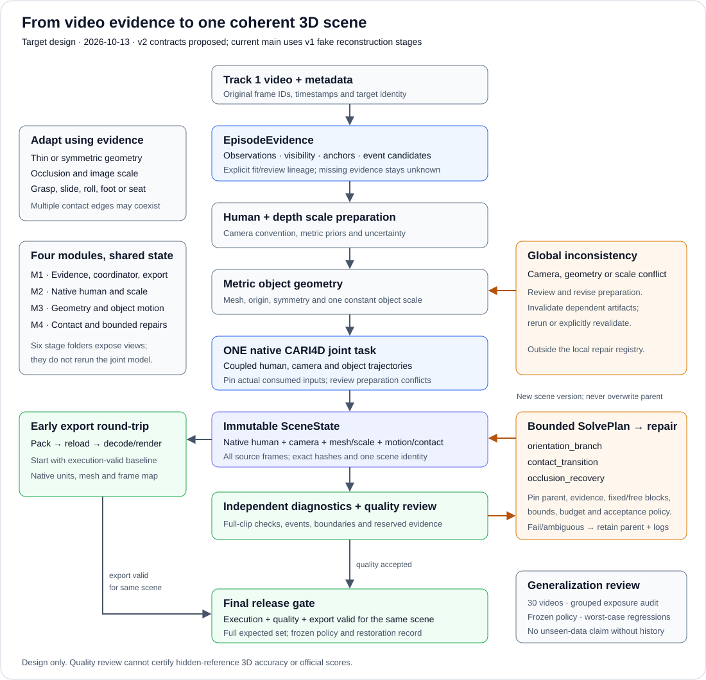
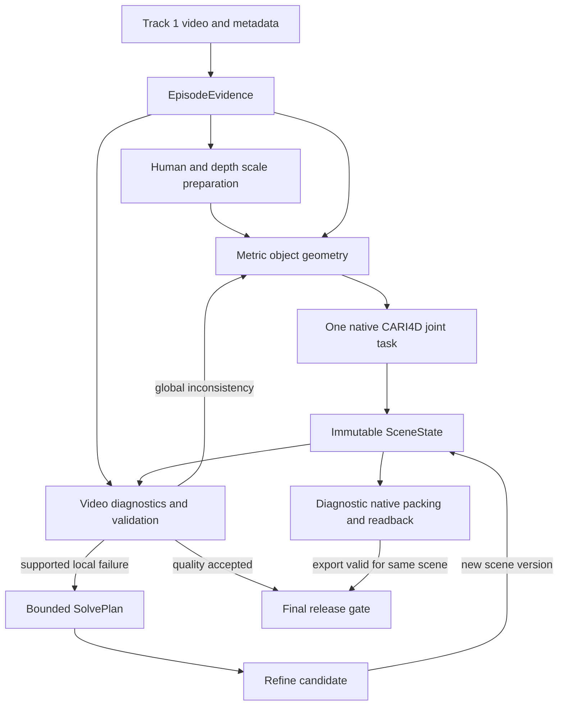

# Track 1 reconstruction design

Updated 2026-10-13. This specifies the video-conditioned pipeline and its integration with the existing modules. The execution graph and v2 contracts below are the target design; the checked-out runtime remains v1 with fake reconstruction stages.

The [P0 component/exposure audit](component-audit.md) and [opt-in v2 foundation](v2-foundation.md) now implement the first audit and structural-storage work packages. They do not wire the real reconstruction graph or close native/quality/export acceptance gates.

Build one reproducible native-MHR CARI4D baseline, preserve it, and add bounded repairs only where independent image evidence supports them. More models, a smaller optimization loss, and a smoother animation are not evidence of better reconstruction.

Follow [track1-requirements.md](track1-requirements.md), the single authoritative statement of the owner's latest six requirements. Read [evaluation.md](evaluation.md) for source-pinned external mechanics and diagnostic limitations, [implementation-plan.md](implementation-plan.md) for delivery packages and G0-G4 gates, [contracts.md](contracts.md) for implemented v1 files, [contracts-v2.md](contracts-v2.md) for the proposed v2 contracts, and [video-coverage.md](video-coverage.md) for the 30-video inventory and validation boundaries.

### Latest project authority: final requirements supplied on 2026-10-03

The requirements are R1–R6 in [the current specification](track1-requirements.md). Older interpretations are superseded. In particular, alignment uses the first reference frame's explicit original-video ID even when a diagnostic scoring subset starts later. External array indexing is an adapter concern; it does not create an alternative alignment rule.

## 1. Scope, evidence, and current status

The task is to reconstruct human motion with hands, object geometry, and object motion from the 30 Track 1 monocular videos and their metadata. The released videos are static-camera sequences, but every adapter must preserve their frame indices, dimensions, image transforms, and timestamps. A camera name is not sufficient evidence of identical intrinsics or extrinsics across videos.

**Track 1 only.** Never download, load, or use Track 2 content or any derivative, including Tier 1/Tier 2 meshes, trajectories, labels, camera parameters, statistics, cached outputs, scores, or tuned parameters. There is no validation, debugging, normalization, or demonstration exception. Independently created synthetic fixtures may test methods and interfaces; they are not submission assets. Exclude assets with unknown provenance. Reading approved evaluation source does not authorize fetching its example data or reference bundles.

| Area | Evidence in the current repository | Still required |
|---|---|---|
| Orchestration | Six stages, upstream runs, v1 files, fake-stage smoke tests | Content-addressed dependencies and real artifact provenance |
| Perception and reconstruction | Fake inputs/human/object/motion; prohibited legacy backends are blocked | Registered, verified real adapters |
| Refinement | Pass-through backend | Real, observation-constrained repairs |
| Export | Internal metadata/parquet/mesh plus decomposed MHR arrays | Native MHR conversion and official export validation |
| Candidate comparison | Prepared recipes and record/ranking validation | Verified extraction of real measurements and comparisons |
| Runtime assets | Source/model manifests and acquisition records | Successful inference and a reproducible accepted baseline |

The checked-out `main` at `0e86889696edc4d81a3c287cb93d76baece4a1d5` restored the tracked tree to the pre-Windows-development state. The inspected `windows-cari4d` tip `fb0bac9` retains native execution, conversion, observation repair and preview experiments. Those components require individual source, dependency and geometry reviews before reuse; their recorded experiments do not make them registered main-branch backends or accepted baselines. In particular, provisional scales, unaccepted pan orientation and contact checks invalidated by object repair remain unresolved. The replacement reference diagnostic is separate from reconstruction/export. Design completion, downloaded weights and synthetic tests do not establish reconstruction quality.

### Evaluation consequences

The current requirements replace the September design's prediction-only acceleration assumption. The inspected external kit uses body-only human acceleration; indiscriminate smoothing and a finger-acceleration optimization campaign are not justified by that metric. Native MHR parameterization must be converted explicitly rather than inferred from matching array sizes. See evaluation.md for formulas, units, explicit frame mapping, source identities and adapter limits.

Track 1 does not expose the reference needed for local official Chamfer and reference-relative acceleration scores. Prediction-geometry penetration can be diagnosed locally, but official PEN also uses reference-derived alignment scale; an unaligned calculation is not the final official score. Keep official metrics, prediction-geometry calculations, image-consistency diagnostics, and synthetic experiments separately named.

## 2. Baseline and upstream boundaries

The documented baseline source pin is the MHR implementation in NVIDIA's video_to_data toolkit at `33129dd0f2d2dcfd1164d43fd076542660756ed2`. The Windows experiments refer to a later upstream revision and compatibility patches; the runtime work package must resolve and freeze one tested source/model/converter combination before execution. Preserve this documented pin until that review records a replacement. Keep code, model identities, preprocessing and outputs intact for the initial baseline. The standalone NVlabs/CARI4D repository and paper are related methods, not interchangeable runtime specifications.

The pinned toolkit accepts RGB, human/object masks, and an already metric object mesh. SAM 3D Objects is external mesh preparation. Its transform/intrinsics sidecars are not automatically consumed; the supplied geometry retains its scale. The native launcher constructs its own MoGe2 depth/intrinsics, human initialization, depth alignment, object tracking, CoCoNet output, and post-optimization. It has no public override for the project's planned shared camera/depth/human artifacts. The internal stages must be adapted explicitly before claiming that those artifacts govern inference.

The default final optimizer is limited: it updates object translation and MHR body rotation controls; object rotation is opt-in. Human root, hand, shape, and scale parameters remain fixed. Its symmetry flag changes temporal treatment; it does not implement a general symmetry group. Its contact eligibility is gated at initialization. Floor/table constraints and independent human image reprojection are additions to develop, not existing baseline capabilities.

Sources: [pinned toolkit README](https://github.com/nvidia-isaac/video_to_data/blob/33129dd0f2d2dcfd1164d43fd076542660756ed2/reconstruction/modules/v2d_cari4d/README.md), [native launcher](https://github.com/nvidia-isaac/video_to_data/blob/33129dd0f2d2dcfd1164d43fd076542660756ed2/reconstruction/modules/v2d_cari4d/lib/run_inference.py), [native optimizer](https://github.com/nvidia-isaac/video_to_data/blob/33129dd0f2d2dcfd1164d43fd076542660756ed2/reconstruction/modules/v2d_cari4d/lib/cari4d/learning/training/mhr_opt_refineout.py).

Do not transplant the standalone implementation's SMPL-era parameterization, mesh scaling procedure, optimizer settings, or paper metrics into this baseline. The [standalone custom-video instructions](https://github.com/NVlabs/CARI4D/blob/main/docs/custom_video.md) are useful research context; their limitations motivate tests, not unmeasured claims about the toolkit fork.

## 3. Video evidence and execution architecture

Use one scene representation and a fixed set of operations across episodes. Input evidence determines the anchor frames, plausible hypotheses, active contact relations and parameters allowed to change. Episode IDs and object names select input records; they do not select hidden solver weights, special-case trajectories or acceptance thresholds. The same stool may be carried or support a seated person, and those intervals require different constraints.

### Module responsibilities

The six existing stages remain responsibility boundaries. The coordinator executes dependency-defined jobs, including one joint native job; it does not call a separate CARI4D inference for each output directory.

| Existing stage | Responsibility in v2 | Shared result |
|---|---|---|
| `inputs` | Source-frame indexing, target association, visible observations, image transforms, anchors and event proposals | `EpisodeEvidence` and preparation inputs |
| `human` | Standalone human/scale preparation, native representation validation, bounded human repair | Explicit preparation prior; final native human from the joint estimate |
| `objects` | Episode-local geometry candidates, physical-scale preparation, canonical frame, topology and symmetry | Versioned geometry paired with pose-frame transforms |
| `motion` | Full-frame object trajectories, orientation hypotheses and visibility-aware trajectory diagnostics | Initial native trajectory and proposed motion repairs |
| `refine` | Execute bounded plans; preserve unrelated variables and report candidate changes | New immutable candidate `SceneState` |
| `export` | Diagnostic packing/read-back of one execution-valid scene; final promotion also requires its quality acceptance | Export manifest and separate export validation |

Platform owns orchestration and the independent validation entry. Human, Object and Physics own the semantics of their states and repair operations. Refinement cannot mark its own lower fitting loss as acceptance.

### Execution graph

Every loop edge creates a new artifact lineage. A global inconsistency is a diagnosis to investigate, not automatic permission to change geometry: the coordinator records the evidence and a preparation revision, then recomputes or explicitly revalidates every affected descendant. Diagnostic packing/read-back begins with the first execution-valid baseline in P2; quality and export checks may run in either order. Final release requires both passing for the same scene, plus complete challenge coverage. No loop overwrites the accepted snapshot.

### Evidence pass

Decode the source timeline before choosing samples. Associate the intended person and required objects, including through occlusion and among background people or similar objects. Keep evidence in original-image coordinates and record every crop, resize and padding operation. Distinguish visible object pixels, reliable background, human occlusion, out-of-frame regions and unknown regions; an empty detector result alone cannot label reliable absence.

The first pass collects masks, image landmarks, sparse correspondences and depth validity at an explicit sampling density. Expensive observations may be sparse while the final reconstruction covers every source frame. Record sampled frame IDs and unobserved intervals rather than inventing dense evidence. Preserve fine contours, handles and holes when selecting resolution; record how observed image size determines a resolution choice under one policy.

Select anchors for complementary visible surfaces, reliable appearance, low blur and boundaries of contact or visibility events. Similar adjacent frames contribute little new geometric information. Keep fit and review observations separate before candidate selection. Anchor selection never changes the R1 reference alignment frame. Task text proposes events; image evidence and later geometry confirm, reject or leave them unresolved.

An observation records what was measured or predicted from an image; a scene estimate records the explanation being optimized. Rendering an estimate back into a pseudo-observation does not create independent evidence. Human, depth and contact predictions with shared upstream inputs can have correlated errors. A model confidence, fit residual and uncertainty of the reconstructed state are separate values.

### Scene variables and lifetimes

| Scope | Variables | Update rule |
|---|---|---|
| Whole episode | Camera assumptions, human identity and structural scales, object shape/scale/canonical frame, static support patches | Initialize from several informative views; change only through a new global preparation revision |
| Every source frame | Native MHR pose/root state, object rigid transform | Complete finite timeline in the shared frame; no per-frame object rescaling |
| Event interval | Grasp, touch, slide, support, release, body/foot contact, visibility | Relations may coexist; boundaries and confidence remain revisable |
| Competing hypothesis | Geometry candidate, symmetry representative, ambiguous orientation, hidden path | Bounded candidate set; eliminate using discriminating observations and record remaining ambiguity |

The rigid target representation follows the submission contract. Visible subpart motion, such as a roller rotating about its handle, must be recorded as a possible representation mismatch rather than silently creating an unsupported articulated export. Local support geometry is estimated from permitted images; it is not a borrowed scene mesh. Cross-episode asset/camera sharing remains disabled.

### Preparation and native joint estimate

Prepare camera, standalone human and depth priors under one declared convention; use reliable visible evidence to establish a metric mesh candidate. Compare geometry candidates with their corresponding anchor poses across several views. Do not simultaneously release focal length, human size, object size and depth bias to improve one projection. Absolute monocular scale remains ambiguous; the human prior anchors a convention and relative scale still requires evidence.

The native adapter then consumes the prepared RGB, masks and metric mesh once. It imports the camera, depth, human, aligned mesh and object trajectory that actually ran as a coherent snapshot. The preliminary human/depth estimates remain labeled preparation priors. They do not override native estimates unless a reviewed hook proves they were consumed. Material scale disagreement between preparation and native inference invalidates acceptance and opens a diagnosed preparation revision.

Native output supplies the initial scene candidate. Execution validity and quality acceptance are recorded separately. Keep the original native result and all conversion discrepancies; an invalid or rejected baseline is never an automatic export fallback.

### Diagnostics and operation selection

The proposed `EpisodeEvidence`, `SceneState` and `SolvePlan` contracts are specified in [contracts-v2.md](contracts-v2.md). `SceneState` is an immutable manifest referencing the existing typed artifacts, not a second independently editable human representation. The first coordinator uses explicit operation rules and bounded iteration counts. It does not require a learned routing model.

| Diagnostic evidence | First investigation or operation | Variables retained |
|---|---|---|
| Inconsistent visible contours across complementary views | Check masks, image transforms, camera and mesh/scale; propose preparation revision only with supporting evidence | Previous accepted scene and all candidate identities |
| Local orientation flip with discriminating appearance | Compare orientation branches, then refit the affected poses | Camera, geometry, object scale, unrelated human state |
| Object hidden but stable grasp supported | Forward/backward trajectory hypotheses constrained by hand-relative motion | Global scene; uncertainty in invisible degrees of freedom |
| Handover, release, foot push or body support | Revise contact relations and solve only justified state blocks | Unrelated body/hand controls and all global variables |
| Object placed with support and image-stationarity evidence | Test a near-static interval with correct support constraints | No hard static lock based only on estimated low speed |
| Both human and object evidence insufficient | Preserve bounded hypotheses or declared weak interpolation | Record unresolved ambiguity; do not manufacture observed motion |

Every plan pins a parent scene, evidence version, fit/review split, operation parameters, fixed/mutable blocks, allowed intervals, iteration/time/memory/hypothesis budgets and rollback target. Unknown operations or missing budgets fail before execution. Geometry/scale/camera revisions are outside the first local-repair operation set. Their review and descendant invalidation are explicit coordinator jobs.

Weights reflect recorded observation reliability and units. They are fixed by the frozen policy for a trial; the optimizer cannot freely reduce them to hide errors. Compare jointly rendered visible surfaces, preserving occlusion and image boundaries. Normalize pixel diagnostics by declared image or target dimensions, keep distances in declared metric units, and use timestamps for time-based diagnostics. Lower prediction-only acceleration cannot certify better motion.

### Local solving and validation

Start from reliable anchors, propagate in both directions and solve overlapping intervals with boundary continuity checks. A reappearance frame can constrain earlier occluded motion. Symmetry-aware comparisons retain appearance distinctions; a smooth representative does not reveal an unobservable spin. Test initial-condition sensitivity and competing hypotheses; a small image residual alone does not establish a unique three-dimensional solution.

Use alternating, bounded updates: object pose first when supported, then relevant native human controls where independent evidence warrants them. Contact changes re-open human/object consistency checks. Grasp can constrain a stable contact region; sliding must allow tangential motion; support constrains normal geometry without inventing known friction or forces. The three first operations are orientation-branch repair, contact-transition repair and occlusion recovery; more complex physical models require a measured failure and separate acceptance.

Validation reads one pinned candidate and its retained baseline. It checks structural validity, provenance, unchanged fixed blocks, full-frame coverage, held-out observations, contact persistence, motion timing and repaired-window boundaries. Acceptance limits are calibrated on development evidence and frozen before candidate comparisons. Accept, reject and unresolved are distinct outcomes; a failed repair leaves the prior accepted state intact. The final pack/reload step validates the exact compiled mesh and human geometry, with an export failure blocking release of that candidate.

### Coordinator and migration boundary

Current `run.py` iterates a fixed stage tuple, and `Run.find()` falls back to the nearest upstream file. The proposed coordinator instead resolves declared inputs by content identity and invokes preparation, joint reconstruction, diagnostics, planning, repair, validation and export jobs. Human and motion directories may expose views of the single joint result; they must not trigger duplicate inference or assemble an accidental mixture of scenes.

Do not bump the runtime contract merely by editing this specification. Implement v2 serializers and validators in a separate reviewed migration, preserve v1 fixtures, and make unsupported conversion fail explicitly. Prior branch experiments enter through reviewed adapters, not a bulk restoration of the reverted tree. The dependency and rollout sequence is in [implementation-plan.md](implementation-plan.md).

## 4. Representation and coordinates

### One authoritative human trajectory

Propose `NativeMHR204` as the authoritative future representation: the official converter's 204 native parameters, comprising a 136-parameter pose trajectory and 68 static scale parameters, plus 45 static shape coefficients and the exact rig/decoder identity. The current v1 decomposed arrays are not this representation. Do not concatenate, pad, truncate, or rename them to manufacture compatibility.

Native parameter units follow the pinned decoder; they are not uniformly metres or radians. In particular, native translation slots must not be populated directly from metre-valued camera translation without the documented conversion. Validate the mapping by decoding known poses, translations, rotations, scale changes, and a real Track 1 initialization through both paths.

Keep identity and anatomical scale stable within a clip through constrained fitting, not just overwriting each frame with a median while leaving inconsistent translations. Cross-clip identity sharing requires both supporting evidence and permission under the data rules.

MHR is the only editable human state. Derive SOMA-X or other diagnostic geometry from that state; do not smooth a second representation independently. Alternative SMPL-family models are candidate proposals only after a documented conversion demonstrates that global motion, scale, and hands survive.

### Camera world and object asset identity

Use a fixed OpenCV camera frame per static-camera clip for internal geometry. Human and object outputs must share that frame for the whole sequence. A scene plane can be represented in camera coordinates; gravity reasoning does not require changing the submission world. Do not invent shared world extrinsics across unrelated videos.

The official object transform, its scale handling, and the unresolved canonical-origin question are specified in evaluation.md. Bake a scale into geometry or apply it through the declared pose contract once, never twice. Native CARI4D can recenter/reorient an input mesh: pair its output poses with the corresponding aligned mesh, or perform a verified inverse conversion.

Bind every pose artifact to the exact mesh hash and canonical frame. A rigid recanonicalization `v_new = C v_old` requires `T_new = T_old C^-1` to preserve world geometry, but that does not necessarily preserve an origin-based trajectory metric. Freeze the origin across comparisons; do not recenter to improve a score. A scale change requires refitting and invalidating dependent results, not hiding scale in a purported SE(3) rotation.

Record the first reference frame's original-video ID explicitly. A later scoring window keeps that fixed human-derived alignment; the first row of a selected array is not an implicit replacement. Inspect initial-frame sensitivity without choosing frames based on unavailable reference results. Export the common scene coordinates; reference alignment belongs to evaluation, not to an exporter that has no reference. No independent object alignment or later per-frame alignment may conceal reconstruction drift.

## 5. Observation quality and scale

### Camera and depth

Start with the native baseline camera. Check background consistency, image dimensions, crop transforms, and static-camera assumptions before replacing it. Shared intrinsics are an optional prior after camera identity and image formation are verified; shared extrinsics must not be inferred from recording dates.

Metric human and depth networks provide scale priors, not physical measurements. Monocular projection is unchanged under a common spatial scale, so a static camera and learned depth do not make absolute scale uniquely observable. Evaluation alignment can remove some common ambiguity; it cannot repair relative human-object scale errors, shape errors, or temporal drift.

Initialize with one human identity/scale estimate and fixed camera, robustly align reliable visible human depth, then estimate object scale from visible object evidence. Inspect stability across well-observed frames and perturbations of the initialization. Do not independently anchor the object to raw depth and the human to a differently scaled depth stream.

This is an explicit mesh-preparation pass before the full native pipeline: obtain real depth and a real standalone human initialization under a documented camera convention, align them, and scale the candidate mesh. Record these preparation estimates separately from the human/depth estimates that the native pipeline recomputes. If they materially disagree, revisit scale before accepting the run. Do not assume that an unscaled mesh can become metric merely by passing it to CARI4D; the preparation adapter is part of G1 work.

During repair, release one coupled variable block at a time. Do not jointly free focal length, human size, object size, and depth bias without sufficient independent constraints. Per-frame scale freedom is especially dangerous. Report sensitivity and competing solutions; do not label an uncalibrated residual score a probability of correctness.

### Masks, depth boundaries, and independent checks

Use one baseline segmentation path, with reviewed prompts/corrections where permitted. Store both the original prediction and any edits. Distinguish absent object evidence from a reliable empty region. Retain holes and fine contours of rings, handles, and thin furniture.

Compare observed visible regions to jointly rendered visible human/object surfaces, accounting for occlusion and the image boundary. A fully projected object silhouette compared to a partially visible mask can reward an incorrectly shrunken mesh. Predicted depth near thin silhouettes, reflections, occlusion boundaries, or invalid pixels must not be treated as precise geometry.

Keep high-resolution image evidence for thin objects and hands. A stride-only depth schema cannot describe every resizing convention; explicit sample/image transforms are part of the future contract. Use held-out visible frames, independently reviewed image landmarks, and forward/backward discrepancies as cross-checks. Agreement between models with the same upstream estimate is weaker evidence than an independent observation.

## 6. Object geometry and difficult cases

Default to episode-local reconstruction until the organizer confirms whether cross-episode joint estimation is permitted. Reusing or jointly fitting one object's three clips is a disabled-by-default experiment, not an official mesh-sharing requirement. Even if permitted, asynchronous interaction clips are not synchronized multiview observations.

Begin with SAM 3D Objects candidates from a small, recorded set of clear, diverse frames. Add another generator only after a specific geometry failure remains. Rank candidates on visibility-aware held-out image evidence, scale stability, and topology inspection. A realistic texture or low penetration score is not sufficient. Never change mesh sampling, holes, scale, or origin merely to make a metric easier.

| Case | Initial modeling choice | Main failure to test |
|---|---|---|
| Hula hoop | Analytic ring candidate alongside generated geometry; fit visible contours and thickness | Lost hole, perspective/normal ambiguity, fast rotation, body passing through |
| Bowl/cylinder-like geometry | Explicit candidate symmetry after checking geometry and observed appearance | Arbitrary yaw jumps or incorrect hard symmetry |
| Pan, iron, brush and block | Preserve handles and other orientation cues | Occlusion mistaken for missing geometry; wrong grip-side pose |
| White desk/cart | Reliable contours, corners and support evidence | Weak texture, foot interaction, off-screen geometry |
| Stool | Complete geometry consistent with visible intervals | Long body occlusion and unsupported assumptions about seat contact |

For bowl cavities, open meshes and thin surfaces, verify the collision representation separately from a convenience convex proxy. Geometry that fills an actual opening can invent penetration. The exact submission mesh remains the authority for official-format calculations.

The official packer can weld, simplify and pad a mesh to its budget. Inspect and render the compiled mesh after read-back, including thin structures, holes and contact surfaces. A high-resolution candidate that is correct before packing can still be an invalid geometric choice after packing.

If cross-episode fitting is approved, optimize shared shape/scale with clip-specific motion and camera assumptions. Test leave-one-clip-out asset estimation: fit geometry from two clips, then fit only motion on the third. This tests transfer of image consistency, not hidden 3D accuracy or generalization to unseen objects.

## 7. Bounded, evidence-gated repair

The complete model can be described as a sum of visible-image, visible-depth, temporal-correspondence, contact, collision, motion and prior terms. This is a specification, not a requirement to implement one large unconstrained optimizer.

Use robust residuals with explicit units and observation reliability. Keep original observations separate from learned priors. Specify the allowed parameter block, interval, displacement bounds, hypothesis budget and rollback rule before each experiment. A lower objective does not justify promotion if independent observations deteriorate.

Camera/scale or mesh/pose-frame inconsistencies return to preparation before motion repair. These revisions invalidate their consumers and are outside the initial repair registry.

The first repair operations are:

1. `orientation_branch`: compare bounded object orientation candidates using visible contours/features and clear anchors, with camera and geometry fixed.
2. `contact_transition`: repair evidenced grasp/release, sliding or support changes. Release bounded human root/body/hand controls only where the plan declares them and independent image anchors constrain them; hand edits require sufficient visible hand or interaction evidence.
3. `occlusion_recovery`: compare bounded bidirectional object-trajectory hypotheses against reappearance and boundary evidence, with global state fixed.

Choose an operation from its diagnosed failure, rather than running all three on every clip. Recheck the full sequence after each candidate, including window boundaries and the authoritative native MHR geometry.

Use reference-relative acceleration implications from evaluation.md. Prediction self-acceleration is a diagnostic, not the target official error. Do not turn rapid real motion into a smooth, wrong trajectory. A static segment must be established from image/support evidence and contact state, not merely low estimated speed; ambiguous intervals retain a soft prior.

### Symmetry and occlusion

Use symmetry-aware rotation distances over the verified equivalence group, rather than averaging distinct poses. Geometric symmetry and appearance symmetry can differ. Approximate symmetry is a soft constraint. Selecting a continuous representative does not make an unobserved spin physically observable.

Track from clear anchors forward and backward. A small fixed set of competing hypotheses may bridge an occlusion; record their differences and use reappearance evidence to choose. During a reliable grip, object motion relative to the hand is more informative than holding the last camera-space pose. Supported sliding, release and regrasp require different states.

Long complete occlusion can remain non-identifiable. Preserve that diagnostic uncertainty even though export requires one continuous trajectory. Filling every frame establishes coverage, not correctness. Do not introduce a learned motion model until these simpler repairs expose a specific remaining failure.

### Contact and collision

Separate hand grasp, foot push, body support, object support and no-contact states. Minimum hand-surface distance alone does not establish a realistic grasp. Where visible evidence supports it, maintain a contact region in object coordinates, allow explicit release/slip, and check tangential motion as well as penetration.

Reducing penetration by moving the hand away can destroy the interaction. Keep the mesh fixed for contact ablations and pair penetration with image fidelity and independently reviewed contact persistence. Uncertain floor/table planes are soft geometric evidence; they are not grounds to invent forces, friction or exact dynamics.

## 8. Validation and promotion

Begin with episodes 16 (foam block) and 12 (pan). Then use `dev-mini = [0, 6, 9, 16, 24]` for varied failures and `dev-full = all 30` for integration. The first-three-video kit covers only hula hoops and cannot select a universal model or establish whole-project readiness.

Every experiment preserves the baseline and records source/model/config hashes, frame mapping, upstream identities, mesh origin/scale, changed variable blocks, runtime, observations used for fitting, observations reserved for review, and before/after overlays. Metadata-only cache signatures are not content hashes; project dependency checks must verify content explicitly. For broader model-selection claims, keep all clips of an object in the same development or holdout group. Same-object leave-one-clip-out checks remain within-development consistency tests, not unseen-object validation. Once a group has influenced decisions, call it a regression group.

Use independent synthetic sequences for known-answer geometry, native conversion, alignment, occlusion, symmetry, collision topology, and acceleration-error tests. Include genuinely accelerating motion: an unchanged correct prediction should have zero reference-relative acceleration error even when its own acceleration is nonzero. Do not estimate test distributions or tolerances from Track 2.

Freeze a comparison protocol after baseline observation and before candidate ranking. Publish per-episode outcomes and the worst failures, not only averages. Frame-adjacent samples are correlated; do not present them as independent replication. No universal numerical pass threshold or automatic promotion is implemented today.

Initial baseline quality acceptance uses the frozen review protocol, complete source overlays, evidence limits and recorded failures; it cannot require improvement over itself. Execution validity alone does not confer quality acceptance. Promote a repaired candidate only when:

- Provenance, native-format validity, frame coverage and asset identity remain valid.
- The targeted failure improves on held-out observation evidence or permitted official results.
- Required image/contact checks do not exceed predeclared degradation limits.
- Repaired-window boundaries and the initial scored region remain coherent.
- A reviewer records trade-offs and an immutable rollback baseline.

A Pareto comparison across accuracy, motion fidelity and contact is preferable to an invented scalar leaderboard formula. Full official scores require the approved reference/evaluation process. Keep publication, deployment and official submission as separate actions from local validation.

## 9. Research hypotheses, not established contributions

Potential research directions are observability-gated shared-asset optimization, event-conditioned symmetry-aware occlusion recovery, and evidence-constrained hand contact repair. Factor graphs, multiple hypotheses, shared shape, and contact losses are established ideas; using them together is not automatically a new method.

Each hypothesis requires an incremental ablation, matched input and compute budgets, natural failure cases, independent synthetic known-answer tests, and comparison against the preserved native baseline. Cross-episode experiments additionally require rule confirmation. Detailed experiment and rejection plans are in implementation-plan.md. If evidence demonstrates integration reliability rather than algorithmic novelty, report that result honestly.

## 10. Historical assumptions and open authority questions

The 2026-09-26 organizer email, preserved in [the earlier design revision](https://github.com/Seanwilliam2077/video-to-hoi/blob/6a53e84/docs/design.md#64-organizers-answers), said acceleration measured predicted trajectories alone. This is retained as dated history, not the active implementation specification. The owner's final requirements supplied on 2026-10-03 explicitly require reference-relative second differences, consistent with the inspected kit. That design choice is resolved; evaluation.md retains the source history and the implementation version to reproduce. Do not silently combine the email, the legacy scorer, the paper, and the current kit.

The old 77-joint/finger acceleration assumption, body-joint alignment approximation, reference-relative penetration approximation, and claim that the official adapter is simply unpublished are superseded by the current source review. No part of that update relaxes the Track 1-only policy.

Before submission, verify the external kit adapter against the current requirements, including explicit original-frame mapping, native conversion, canonical object origin and operational compatibility. Resolve permitted cross-episode estimation separately. These implementation questions do not reopen R1–R6. Use G0-G4 gates rather than the expired date-based September schedule.
