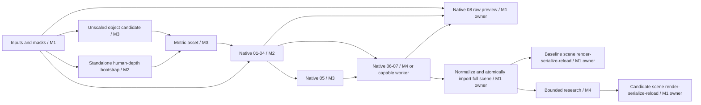

# Execution across independent machines

**Design proposal, 2026-10-13.** Each teammate runs assigned stages on a machine they can access; Git coordinates code, input identities and reviews, while verified result packages carry large files. No shared server account or shared filesystem is required. [The JSON profile](distributed-execution.json) describes an acyclic design, not an executable workflow or implemented CLI. Current `main` still uses the v1 fake runtime; the [v2 foundation](v2-foundation.md) does not yet execute this design.

## Source and acceptance boundary

The cuts below follow the eight native stage calls recorded in the pinned Windows branch, rather than assuming that the four team modules are four independent final models. Read-only source/history review does not certify a running multi-host backend.

| Source | Identity and use |
| --- | --- |
| Windows candidate | `fb0bac9f02d346d32e086036c80f7c3041978d56`; `src/v2hoi/native.py`, `tools/windows/audit_stage_commands.py`, `deployment/windows/episode16-stage-audit.json` record eight calls and their inputs |
| Reported executed upstream | [`193382a184308f6800331f3db829f76dc4294cfe`](https://github.com/nvidia-isaac/video_to_data/blob/193382a184308f6800331f3db829f76dc4294cfe/reconstruction/modules/v2d_cari4d/lib/run_inference.py); reference for the proposed native stage cuts |
| Earlier recipe/source pin | [`33129dd0f2d2dcfd1164d43fd076542660756ed2`](https://github.com/nvidia-isaac/video_to_data/blob/33129dd0f2d2dcfd1164d43fd076542660756ed2/reconstruction/modules/v2d_cari4d/lib/run_inference.py); historical deployment candidate, not interchangeable with the executed pin |
| Existing decisions | [Component audit](component-audit.md), [implementation plan](implementation-plan.md), [current R1-R6](track1-requirements.md) |

Select one coherent scientific source/model/rig/converter/configuration set before execution. Each stage may use a different reviewed OS, Python and CUDA environment, with its effective source patches and numerical settings recorded. Equal source pins alone do not establish numerical equivalence across machines. Track 1-only provenance and R1-R6 remain mandatory; unknown or Track 2-derived assets cannot enter any package.

## Proposed division of work

An owner is accountable for an output; the worker is whichever teammate has a compatible machine. Owning M1's export does not imply that M1 has a GPU. Resource assignments remain pending an actual inventory of GPU/VRAM, OS/driver, disk, network and available time; no measured minimum VRAM is asserted here.

| Package / stage | Default owner / worker | Exact dependency and deliverable |
| --- | --- | --- |
| Inputs and masks | M1 / suitable segmentation GPU | Original video hash, decoded original-frame/PTS map, dimensions, target IDs, complete masks, prompts and image transforms; one immutable input revision |
| Standalone human/depth bootstrap | M2 / human GPU | Consumes the input package; produces selected-frame human geometry, depth/intrinsics, scale evidence and model identities. This is preparation, not the final human trajectory |
| Unscaled object candidate | M3 / object GPU or reviewed asset preparation | Consumes the input package; produces candidate geometry, canonical axes/origin and source-frame/annotation lineage. Can run alongside bootstrap. Any depth-conditioned generation must explicitly wait for and reference its bootstrap inputs |
| Metric asset | M3, with M2 review | Consumes bootstrap and object candidate; produces physical-scale mesh, scale policy, canonical transform, appearance and fit/review evidence. Revisions invalidate downstream native stages |
| Native 01-04 | M2 / human GPU | `01_depth`, `02_export`, `03_human_initialization`, `04_depth_alignment`; consumes the complete input package and metric asset; transfers the full prepared export, depth/intrinsics, initialized MHR, aligned depth, aligned mesh and source records |
| Native 05 | M3 / FoundationPose GPU | `05_object_pose`; consumes exact native 01-04 products and mesh; produces complete FoundationPose initialization/tracking and diagnostics |
| Native 06-07 | M4 / compatible joint-inference GPU | `06_coconet`, `07_refinement`; consumes exact native 01-05 products; produces coupled human/object bundles, native checkpoints, diagnostics and effective configuration |
| Native 08 raw preview | M1 / M2 or M4 GPU when needed | `08_render` consumes the original prepared export, source video, aligned mesh and CoCoNet/refined native bundles. Its output documents the raw native run; it cannot consume an arbitrary repaired SceneState |
| Atomic scene import and normalization | M1 / M2 or M4 GPU when needed | Checks the complete logical native run and all inputs; invokes the pinned MHR decoder/converter to normalize native human results to pose `[T,136]`, shape `[45]`, scales `[68]` and the shared scene frame. Preserve raw artifacts, conversion settings and measured mapping/fitting error before publishing one coherent full scene |
| Bounded research | M4 / suitable optimization worker | Consumes an execution-valid immutable baseline and frozen observations; creates a separate candidate under a bounded SolvePlan. The ordinary baseline remains available for comparison |
| Scene-bound render, official serialization and reload | M1 / M2 or M4 GPU when needed | Serialize the already normalized, validated parameters of each exact baseline/candidate; reload, decode and render that same scene. No second independent fitting or implicit call to native `08_render`; GPU-dependent decoding/rendering must remain available |

The first baseline should follow the unmodified native 01-07 sequence before research repairs. Standalone bootstrap estimates do not silently override the depth/human estimates recomputed by native 01-04. Compare their scale consistency and reopen preparation if they disagree.

**Do not split the same clip by time between teammates.** Native tracking, temporal context, contact optimization and export coverage depend on the complete sequence. After a full-episode transfer rehearsal succeeds, independent complete episodes can be distributed between equivalent workers.

## Dependency graph and the bootstrap cycle



Native `02_export` prepares object-inclusive inputs before native human initialization. The alignment path also expects the prepared `wild_export.json` marker. Therefore a safe first implementation keeps native 01-04 together, with the real metric asset already present. It must not create a fake mesh or forged completion marker to break the dependency cycle. The standalone bootstrap supplies the earlier scale evidence. A genuine human-only native export view is a future optimization requiring a source adapter and parity checks; it is not assumed here.

Native 08 is a side job and does not block normalization or research. Final review can require its raw visual evidence alongside scene-bound previews; the normalization adapter does not read a rendered preview.

## What crosses Git and what crosses storage

| In Git, through module branches and PRs | In a local cache / Release / agreed team storage |
| --- | --- |
| Source, stage configuration, schema, small immutable result manifests, input/output hashes, reviews, selected package references | Videos, masks, depth, native arrays, meshes, large logs/previews, runtime archives and permitted model packages |
| Package locations without credentials, archive/part sizes and SHA-256, exact required common-package identities | Personal credentials and machine-local paths stay local; permitted model access is handled independently |

The project already uses GitHub Release assets for large handoffs, making them the default transport candidate. A team object store is an alternative if access, throughput or visibility makes it preferable. This document authorizes no upload and records no new publication. Existing licenses and data-sharing permissions still apply to the chosen location. Do not place weights and per-frame outputs in ordinary Git history; introducing Git LFS or a new data platform is unnecessary for the initial rehearsal.

Publish a frozen common input package once, then stage-result packages containing new outputs and references to exact required packages. The union must contain the complete transitive dependency closure. Stage-specific adapters must enumerate actual native file reads, including paths/dependencies embedded in `.pth`, `.pkl` and other binary metadata; following declared JSON references alone cannot prove a complete native read set. Inspect such formats only through the trusted pinned adapter; reject unknown or unresolved dependencies. Consumers resolve hashes, not a mutable `latest` folder. A package's download location may change without changing its content identity.

Proposed repository layout, subject to the adapter implementation:

```text
handoffs/<episode>/<logical-run-id>/<stage>/<result-id>.json
configs/distributed/<profile>.json
reviews/<episode>/<result-id>.json
```

Each new result gets a new identifier. No teammate overwrites another person's accepted file. Small canonical JSON files need fixed byte/newline treatment in Git to prevent cross-platform hash drift. Native binaries retain their exact bytes.

## New transport envelope and import rules

Three separate immutable records are proposed; none is an already implemented v2 record type:

- **Producer StageResult:** schema/result ID, logical native run ID, stage ID, episode, `source_kind`, original video/timeline hashes, targets, exact predecessor/input/output references, producer code/model/rig/configuration/environment/command, seeds and numerical deviations, source-policy review, completed execution and adapter-observed file-read inventory.
- **TransportManifest:** exact StageResult reference, common-package requirements and closure inventory (relative path, bytes, SHA-256, media type), plus archive/part hashes calculated after packing. It lives outside the archive it hashes, preventing a self-hash cycle.
- **ReceiverReceipt:** exact StageResult and TransportManifest references, receiver verification outcome, local materialization mapping and relocation evidence. It is published separately after verification; it never edits the producer's record. Quality acceptance remains separate.

A minimal adapter needs three operations: **pack**, **verify**, and **import**. These are proposed operations, not runnable commands. Packing reconciles declared references, nested JSON and the native adapter's complete file-read inventory, verifies the closure, then publishes its external TransportManifest. Verification rejects path traversal, missing/stale/unknown dependencies, hash mismatches and disallowed provenance. Import stages files in quarantine, verifies them, and registers immutable records only after applicable semantic checks; a separate ReceiverReceipt records the outcome. Import never changes an accepted selection or upgrades execution, quality or export status.

Native files and stage/cache markers can embed absolute paths. Preserve original files and execution evidence; materialize a new local view with an explicit old-to-new path map and new hashes for any rewritten metadata. Record that view in the separate receiver receipt rather than mutating the producer's manifest; subsequent execution names both its source StageResult and actual materialized input hashes. Native path-based cache signatures are not cross-machine proof: the adapter must validate the exact inputs and decide whether to rebuild a cache or resume. Copying a `.stages` directory cannot certify that a stage ran on the receiving machine.

Each machine has an independent local ArtifactStore. Do not synchronize `.registry.lock` or `.selections`, and do not assume the current local atomic-write guarantees work over network filesystems. The current scene validators verify declarations and dependencies but do not enforce this multi-host stage sequence. The adapter must add logical-run consistency, exact predecessor consumption, expected-output coverage and one atomic full-scene publication before distributed execution can be accepted.

Keep scientific input identities separate from credentials and machine paths. Receiver validation policy is local and reviewed; importing a producer's self-declared passing report must not automatically add its validator/configuration to the trusted set.

## Reuse and remaining engineering

| Existing component | Reuse | Gap to implement |
| --- | --- | --- |
| `tools/prepare_bundle.py` | Source/asset inventory and safe packaging patterns | Excludes runtime `runs/`; not an inference-output packer |
| `tools/prepare_model_release.py` | Per-file/part hashes and reviewed model packaging | Model-specific policy; not a general StageResult packer |
| `tools/restore_model_release.py`, `restore_handoff.py` | Verified part restoration and immutable publication patterns | Existing wrapper only permits named historical releases; no new run transport or semantic import |
| `v2/artifacts.py`, `v2/contracts.py` | Immutable refs, local CAS and recursive semantic/dependency checks | Streaming large files, transport closure, native adapters, relocation and stage coordination |

Use a thin file-based coordinator and explicit commands first. A distributed queue, shared database, automatic cloud scheduler or universal container would consume time without proving the reconstruction or research claim. Model runtimes stay isolated by stage; common logical identities and tested interfaces provide coherence.

## Three-day adapter rollout goals

These are goals after owners, compatible machines and access are confirmed, not promises based on unmeasured resources. Preparation and innovation prototypes continue in parallel.

| Day | Deliverable and acceptance |
| --- | --- |
| 1 | Freeze one source/model/configuration set and the stage/result interfaces. Record machine capabilities. Implement local pack/verify/import with independent synthetic fixtures; exercise two independent roots, corrupt/missing dependencies, retries and unchanged selection |
| 2 | Materialize native 01-04 products on another machine and run native 05 with verified consumed inputs. Test path relocation and cache handling. Transfer native 05 to the 06-07 worker; retain complete stage records and compare against the same pinned baseline where feasible |
| 3 | Complete one full engineering episode across at least two actual hosts, preserve the native 08 preview, normalize native parameters with recorded conversion error, atomically publish its scene, then serialize/reload/decode/render that exact scene. Record bytes transferred, timings, environment differences and quality defects. Repeat on the other engineering episode before full batch rollout |

If transport or relocation fails, keep the same package interfaces and temporarily co-locate adjacent native stages on a capable worker; other modules continue locally. This preserves the scientific baseline and ownership without forcing everyone onto one server. The next release gate remains real native conversion and all-frame evidence, not a successful ZIP transfer.
